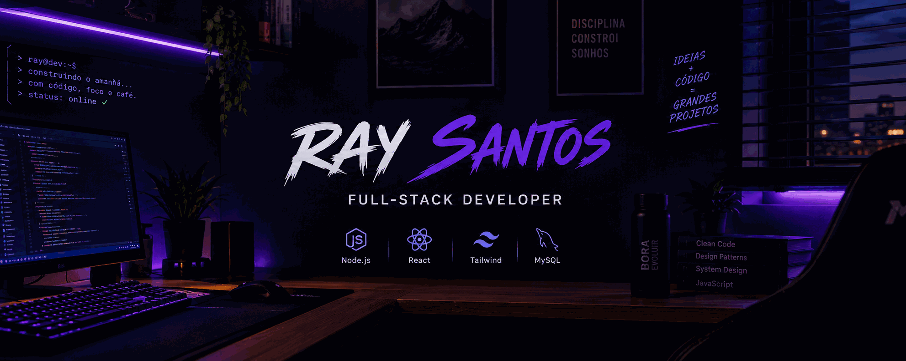

 <div align="center">



<a href="https://git.io/typing-svg">
  
</a>

<br />


<br /><br />

<a href="https://programas-three.vercel.app"></a>
<a href="https://linkedin.com/in/SEU-USUARIO"></a>
<a href="https://instagram.com/ray_sant0ss_"></a>

</div>


</div>

---

## 👾 PLAYER PROFILE

```js
const player = {
  name: "Ray Santos",
  class: "Full-Stack Developer",
  region: "Ceará, Brasil",
  specialization: ["APIs", "Dashboards", "Business Systems"],
  mainWeapons: ["Node.js", "React", "MySQL"],
  currentlyLearning: ["SQL avançado", "Autenticação"],
  objective: "Transformar problemas reais em software."
};
```

Desenvolvedor focado em criar **sistemas web, APIs e dashboards interativos**. Gosto de transformar processos manuais em soluções digitais, trabalhar com dados em tempo real e construir interfaces que combinam funcionalidade com uma boa experiência de uso.

Meu objetivo é evoluir constantemente, desenvolver projetos úteis e dominar cada vez mais o ecossistema JavaScript.

## 🕹️ DEVELOPER QUESTS

<table>
<tr>
<td width="50%" valign="top">

### ⚔️ MAIN QUEST

**Sistemas em tempo real**

- [x] Desenvolver APIs REST
- [x] Criar interfaces com React
- [x] Integrar aplicações com MySQL
- [ ] Evoluir arquitetura e segurança
- [ ] Aprimorar performance e escalabilidade

</td>
<td width="50%" valign="top">

### 🧪 SIDE QUESTS

**Novas habilidades**

- [x] Git e GitHub
- [x] Node.js e Express
- [x] React e Tailwind CSS
- [ ] SQL avançado
- [ ] Autenticação e autorização
- [ ] Infraestrutura e deploy

</td>
</tr>
</table>

## 🧰 INVENTORY — TECH STACK

<div align="center">

### 🖥️ Frontend


### ⚙️ Backend & Database


### 🔧 Developer Tools


</div>

## 🚀 ACTIVE MISSIONS

<table>
<tr>
<td width="50%" valign="top">

### 📊 Live Sales Ranking

Sistema de ranking de vendas com atualização em tempo real, metas e visualização para dashboards e TVs.

**Tech:** `Node.js` `Socket.IO` `Prisma` `React` `Tailwind`

</td>
<td width="50%" valign="top">

### 🎯 Lead Management CRM

Sistema para organizar leads comerciais e desenvolver fluxos de distribuição e acompanhamento de oportunidades.

**Tech:** `Node.js` `Express` `MySQL`

</td>
</tr>
<tr>
<td width="50%" valign="top">

### 📄 Document Automation

Automação para gerar propostas e documentos a partir de dados estruturados.

**Tech:** `Node.js` `Excel` `Word`

</td>
<td width="50%" valign="top">

### 🔍 OCR Document Scanner

Projeto para explorar reconhecimento de texto em documentos e automatizar o preenchimento de informações.

**Tech:** `Node.js` `OCR` `DOCX`

</td>
</tr>
</table>

## 📡 PLAYER STATS

<div align="center">


<br />


</div>

## 🏆 ACHIEVEMENT ROOM

<div align="center">


</div>

## 🌌 CONTRIBUTION MATRIX

<div align="center">


</div>

---

<div align="center">

### 💜 KEEP BUILDING. KEEP EVOLVING.

<code>while (alive) { learn(); build(); improve(); }</code>

<br /><br />


</div>
